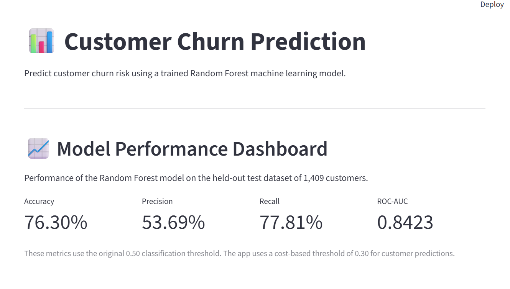
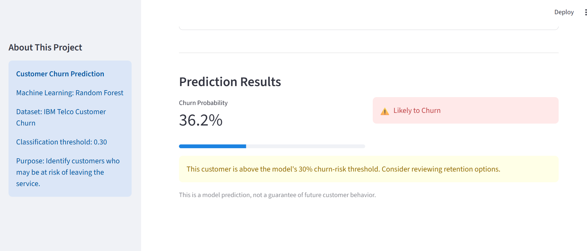

# Customer Churn Prediction

An end-to-end machine learning project that predicts customer churn using a Random Forest classifier trained on the IBM Telco Customer Churn dataset.

The project includes data preprocessing, model evaluation, cost-based threshold selection, a JSON-exported model, and an interactive Streamlit application.

## Project Overview

Customer churn occurs when customers stop using a company's services. Identifying customers who are at risk of leaving can help businesses plan targeted retention strategies.

This project uses customer demographics, account information, service subscriptions, and billing details to estimate churn probability.

## Features

- Interactive customer churn prediction
- Random Forest classification model
- Churn probability and risk classification
- Model performance dashboard
- Confusion matrix and classification metrics
- Cost-based classification threshold selection
- Pure-Python inference using a JSON model export
- Streamlit web application

## Dataset

**Source:** IBM Telco Customer Churn dataset

The dataset contains 7,043 customer records and 21 columns, including customer demographics, subscribed services, contract details, billing information, and churn status.

The target variable is `Churn`.

| Churn status | Customers | Percentage |
|---|---:|---:|
| No | 5,174 | 73.46% |
| Yes | 1,869 | 26.54% |

The dataset has a class imbalance, with fewer customers churning than staying.

## Machine Learning Workflow

1. Data loading and exploratory analysis
2. Missing-value handling
3. Train-test split with stratification
4. Numerical preprocessing using median imputation and standardization
5. Categorical preprocessing using most-frequent imputation and one-hot encoding
6. Training and comparison of Logistic Regression, Decision Tree, and Random Forest
7. Feature importance analysis
8. Classification threshold and business-cost analysis
9. JSON model export and Streamlit deployment

## Model Results

The Random Forest model was evaluated on a held-out test set of 1,409 customers.

At the default classification threshold of 0.50:

| Metric | Score |
|---|---:|
| Accuracy | 76.30% |
| Precision | 53.69% |
| Recall | 77.81% |
| F1-score | 63.54% |
| ROC-AUC | 0.8423 |

### Cost-Based Threshold

A threshold of 0.30 was selected from the tested thresholds using these illustrative cost assumptions:

- False negative cost: 110
- False positive cost: 10

At threshold 0.30, the test-set confusion matrix is:

| | Predicted Stay | Predicted Churn |
|---|---:|---:|
| Actual Stay | 598 | 437 |
| Actual Churn | 38 | 336 |

The resulting total assumed cost is:

`(38 × 110) + (437 × 10) = 8,550`

The threshold is based on the stated hypothetical costs, not verified company retention costs.

## Technologies Used

- Python
- Pandas
- NumPy
- Scikit-learn
- Matplotlib
- Streamlit
- JSON

## Project Structure

```text
customer-churn-prediction/
├── app.py
├── predictor.py
├── churn_model.json
├── requirements.txt
├── README.md
└── screenshots/
    └── dashboard.png
```

## Run Locally

Clone the repository:

```bash
git clone https://github.com/YOUR_USERNAME/customer-churn-prediction.git
cd customer-churn-prediction
```

Install dependencies:

```bash
pip install -r requirements.txt
```

Launch the application:

```bash
streamlit run app.py
```

## Limitations

- Predictions are based on historical customer data and do not guarantee future behavior.
- The cost assumptions are illustrative.
- The selected threshold was explored using the test set, so its reported cost is not an unbiased final estimate.
- Feature importance indicates predictive contribution, not causation.
- The model has not been validated on a separate real-world customer population.

## Future Improvements

- Select the classification threshold on validation data.
- Add batch predictions from uploaded CSV files.
- Add model monitoring and drift detection.
- Evaluate additional models and calibration methods.
- Deploy the application publicly.

## Disclaimer

This project is for educational and portfolio purposes. Predictions should not be used as the sole basis for customer retention decisions.

## Author

Pooja MK

GitHub: https://github.com/poojamk17

## Screenshots

### Model Performance Dashboard



### Customer Churn Prediction

